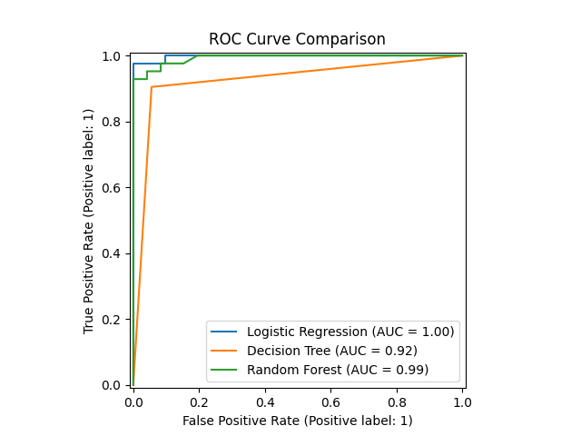
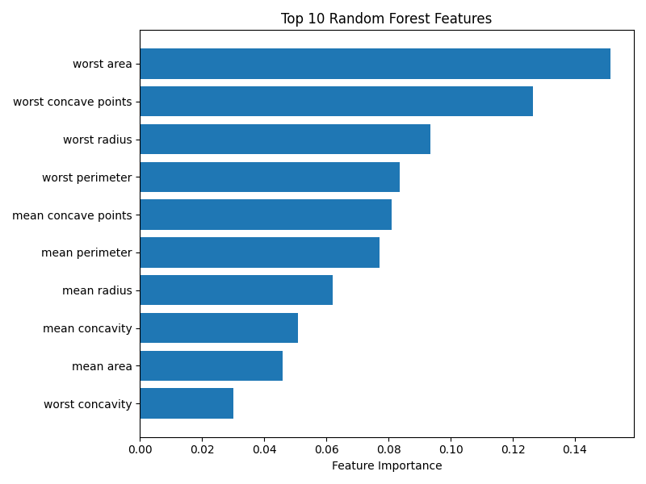
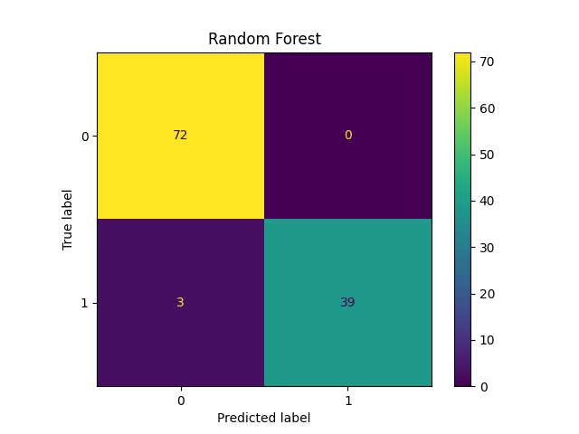

# Breast Cancer ML Classification Pipeline

A machine learning pipeline for breast cancer classification using
Logistic Regression, Decision Tree, and Random Forest models.

The project focuses not only on classification accuracy but also on
clinically relevant evaluation metrics such as sensitivity,
specificity, ROC-AUC, and false-negative analysis.

## Motivation

Early and accurate classification of breast tumours is an important
problem in medical decision support.

This project explores how classical machine learning models can be
used to classify breast cancer cases as benign or malignant.

Rather than evaluating models using accuracy alone, the project
examines sensitivity, specificity, F1-score, ROC-AUC, and confusion
matrices to better understand each model's behaviour.

## Dataset

The project uses the Breast Cancer Wisconsin Diagnostic dataset
available through scikit-learn.

The dataset contains numerical measurements describing characteristics
of cell nuclei obtained from breast mass samples.

The target variable is converted to:

- 0 → Benign
- 1 → Malignant

The features include measurements related to:

- Radius
- Texture
- Perimeter
- Area
- Smoothness
- Compactness
- Concavity
- Concave points
- Symmetry
- Fractal dimension

## Methodology

The pipeline consists of the following stages:

1. Dataset loading
2. Data preparation
3. Train/test splitting
4. Feature scaling
5. Model training
6. Model evaluation
7. Model comparison
8. Feature importance analysis

### Train/Test Split

The dataset is divided into:

- 80% training data
- 20% testing data

A fixed random state is used to make the experiment reproducible.

Stratified splitting is used so that the class distribution is
maintained between the training and testing sets.

### Logistic Regression

Logistic Regression is used as a linear classification baseline.

Because the feature values have different scales, standardized
features are used for Logistic Regression.

The model outputs a probability that is converted into a class
prediction.

### Decision Tree

Decision Trees classify samples by recursively splitting the feature
space according to feature-based decision rules.

Feature scaling is not required for the Decision Tree.

### Random Forest

Random Forest is an ensemble learning method consisting of multiple
Decision Trees.

Each tree contributes to the final prediction, allowing the ensemble
to model nonlinear relationships in the data.

Feature scaling is not required for Random Forest.

## Evaluation Metrics

The models are evaluated using multiple metrics.

### Accuracy

Measures the proportion of correctly classified samples.

### Precision

Measures how many samples predicted as malignant were actually
malignant.

### Sensitivity / Recall

Measures the proportion of malignant cases correctly identified.

Sensitivity is particularly important in this application because
false-negative predictions represent malignant cases classified as
benign.

### Specificity

Measures the proportion of benign cases correctly identified.

### F1 Score

Provides a balance between precision and recall.

### ROC-AUC

Measures the model's ability to discriminate between the two classes
across different classification thresholds.

## Results

| Model | Accuracy | Sensitivity | Specificity | ROC-AUC |
|---|---:|---:|---:|---:|
| Logistic Regression | 98.24% | 95.23% | 100% | 0.997 |
| Decision Tree | 92.98% | 90.47% | 94.44% | 0.924 |
| Random Forest | 97.36% | 92.85% | 100% | 0.992 |

### Results Interpretation

Logistic Regression achieved the highest overall accuracy and
specificity among the three models and produced a very high ROC-AUC.

Random Forest achieved comparable sensitivity and ROC-AUC while also
providing feature-importance estimates.

Decision Tree achieved lower overall performance compared with the
other two models.

### Clinical Interpretation

The confusion matrices were examined to understand false-negative
predictions.

False negatives are particularly important in this problem because
they correspond to malignant cases predicted as benign.

Therefore, model evaluation was not based on accuracy alone.

## Visual Results

### ROC Curve

### Random Forest Feature Importance

### Logistic Regression

### Decision Tree

### Random Forest

## Feature Importance Interpretation

The Random Forest identified tumour size and shape-related variables,
including worst area, worst concave points, worst radius, and worst
perimeter, among the most important predictive features.

These feature-importance values indicate predictive usefulness within
the trained model. They should not be interpreted as evidence that
these features causally cause cancer.

## Limitations

This project has several limitations:

- The evaluation uses a single train/test split.
- The dataset is relatively small compared with real-world medical
  datasets.
- The dataset does not represent the full diversity of clinical
  populations.
- The models have not been externally validated on an independent
  clinical dataset.
- Feature importance should not be interpreted as biological causality.
- The system is a research/educational model and is not a clinically
  validated diagnostic tool.

## Future Work

Potential extensions include:

- Cross-validation
- Hyperparameter optimization
- Probability calibration
- Class-imbalance analysis
- Explainable AI methods
- Deep learning approaches
- Medical image analysis
- Evaluation on independent datasets