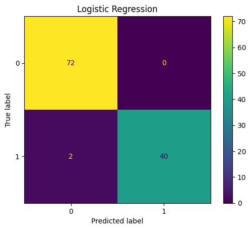
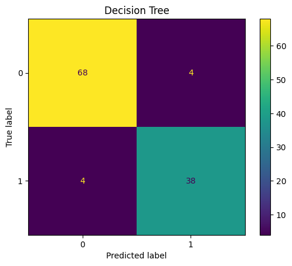
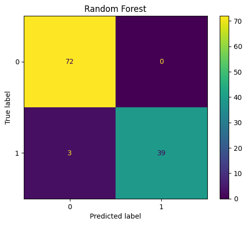
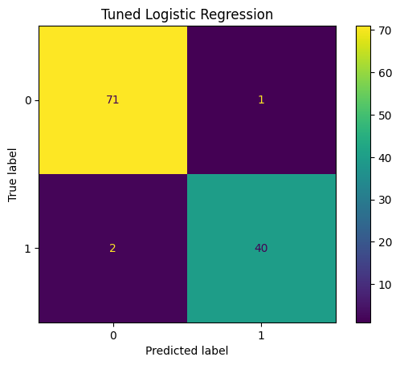
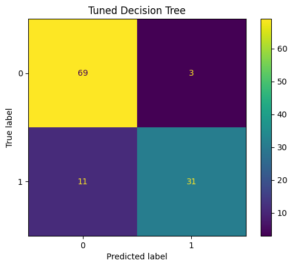
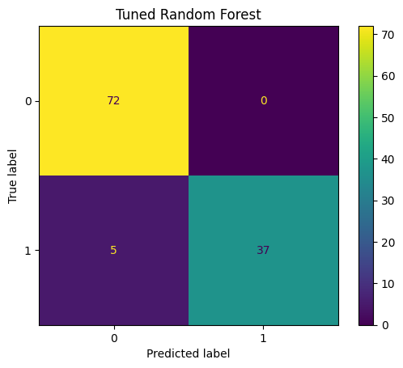

# Breast Cancer ML Classification Pipeline

A machine learning pipeline for breast cancer classification using
Logistic Regression, Decision Tree, and Random Forest models.

The project focuses not only on classification accuracy but also on
clinically relevant evaluation metrics such as sensitivity,
specificity, ROC-AUC, and false-negative analysis.

## Motivation

Early and accurate classification of breast tumours is an important
problem in medical decision support.

This project explores how classical machine learning models can be
used to classify breast cancer cases as benign or malignant.

Rather than evaluating models using accuracy alone, the project
examines sensitivity, specificity, F1-score, ROC-AUC, and confusion
matrices to better understand each model's behaviour.

## Dataset

The project uses the Breast Cancer Wisconsin Diagnostic dataset
available through scikit-learn.

The dataset contains numerical measurements describing characteristics
of cell nuclei obtained from breast mass samples.

The target variable is converted to:

- 0 → Benign
- 1 → Malignant

The features include measurements related to:

- Radius
- Texture
- Perimeter
- Area
- Smoothness
- Compactness
- Concavity
- Concave points
- Symmetry
- Fractal dimension

## Methodology

The pipeline consists of the following stages:

1. Dataset loading and preprocessing
2. Stratified train/test splitting
3. Feature scaling where required
4. Baseline model training
5. Stratified 5-Fold Cross-Validation
6. Hyperparameter tuning using GridSearchCV
7. Evaluation on an untouched test set
8. Baseline vs tuned model comparison
9. Confusion matrix and ROC analysis
10. Random Forest feature importance analysis

### Train/Test Split

The dataset is divided into:

- 80% training data
- 20% testing data

A fixed random state is used to make the experiment reproducible.

Stratified splitting is used so that the class distribution is
maintained between the training and testing sets.

### Logistic Regression

Logistic Regression is used as a linear classification baseline.

Because the feature values have different scales, standardized
features are used for Logistic Regression.

The model outputs a probability that is converted into a class
prediction.

### Decision Tree

Decision Trees classify samples by recursively splitting the feature
space according to feature-based decision rules.

Feature scaling is not required for the Decision Tree.

### Random Forest

Random Forest is an ensemble learning method consisting of multiple
Decision Trees.

Each tree contributes to the final prediction, allowing the ensemble
to model nonlinear relationships in the data.

Feature scaling is not required for Random Forest.

### Cross-Validation

Stratified 5-Fold Cross-Validation is performed on the training data.

Stratification preserves the benign/malignant class distribution in
each fold and provides a more reliable estimate of model performance
than a single validation split.

For Logistic Regression, scaling is performed inside an sklearn
Pipeline so that the scaler is fitted separately within each
cross-validation fold, preventing data leakage.

### Hyperparameter Tuning

GridSearchCV is used to optimize the hyperparameters of Logistic
Regression, Decision Tree, and Random Forest.

Multiple evaluation metrics are calculated during tuning, including:

- Accuracy
- Sensitivity
- F1-score
- ROC-AUC

The models are refitted using ROC-AUC as the primary optimization
criterion.

The held-out test set is not used during hyperparameter tuning.

## Evaluation Metrics

The models are evaluated using multiple metrics.

### Accuracy

Measures the proportion of correctly classified samples.

### Precision

Measures how many samples predicted as malignant were actually
malignant.

### Sensitivity / Recall

Measures the proportion of malignant cases correctly identified.

Sensitivity is particularly important in this application because
false-negative predictions represent malignant cases classified as
benign.

### Specificity

Measures the proportion of benign cases correctly identified.

### F1 Score

Provides a balance between precision and recall.

### ROC-AUC

Measures the model's ability to discriminate between the two classes
across different classification thresholds.

## Results

### Hyperparameter Tuning Results

| Model | CV ROC-AUC | CV Sensitivity | CV Accuracy | CV F1 |
|---|---:|---:|---:|---:|
| Logistic Regression | 0.9959 | 95.29% | 97.36% | 96.40% |
| Decision Tree | 0.9559 | 87.65% | 92.31% | 89.47% |
| Random Forest | 0.9891 | 95.29% | 96.70% | 95.57% |

Best hyperparameters identified by GridSearchCV:

- **Logistic Regression:** C=1, solver=liblinear
- **Decision Tree:** criterion=gini, max_depth=5, min_samples_leaf=4, min_samples_split=10
- **Random Forest:** n_estimators=200, max_depth=10, max_features=log2, min_samples_leaf=1, min_samples_split=2

## Test Set Results

| Model | Accuracy | Sensitivity | Precision | Specificity | F1 | ROC-AUC | FN | FP |
|---|---:|---:|---:|---:|---:|---:|---:|---:|
| Logistic Regression | 98.25% | 95.24% | 100.00% | 100.00% | 97.56% | 0.9977 | 2 | 0 |
| Decision Tree | 92.98% | 90.48% | 90.48% | 94.44% | 90.48% | 0.9246 | 4 | 4 |
| Random Forest | 97.37% | 92.86% | 100.00% | 100.00% | 96.30% | 0.9929 | 3 | 0 |
| Tuned Logistic Regression | 97.37% | 95.24% | 97.56% | 98.61% | 96.39% | 0.9960 | 2 | 1 |
| Tuned Decision Tree | 87.72% | 73.81% | 91.18% | 95.83% | 81.58% | 0.9654 | 11 | 3 |
| Tuned Random Forest | 95.61% | 88.10% | 100.00% | 100.00% | 93.67% | 0.9942 | 5 | 0 |

### Results Interpretation

The baseline Logistic Regression achieved the strongest performance on
the held-out test set, with 98.25% accuracy, 95.24% sensitivity, and a
ROC-AUC of approximately 0.998.

Hyperparameter tuning did not improve every test-set metric.

The tuned Random Forest produced a slightly higher ROC-AUC than the
baseline Random Forest, but its sensitivity decreased and the number
of false-negative predictions increased.

A similar effect was observed for the tuned Decision Tree: ROC-AUC
improved, while sensitivity and overall accuracy decreased.

This demonstrates that optimizing a model for one metric, such as
ROC-AUC, does not guarantee improvement in threshold-dependent metrics
such as sensitivity or accuracy.

The held-out test set was used only for final evaluation rather than
for hyperparameter selection.

### Clinical Interpretation

The confusion matrices were examined to understand false-negative
predictions.

False negatives are particularly important in this problem because
they correspond to malignant cases predicted as benign.

Therefore, model evaluation was not based on accuracy alone.

## Visual Results

### ROC Curve

### Random Forest Feature Importance

### Logistic Regression

### Decision Tree

### Random Forest

### Tuned Logistic Regression

### Tuned Decision Tree

### Tuned Random Forest

## Feature Importance Interpretation

The Random Forest identified tumour size and shape-related variables,
including worst area, worst concave points, worst radius, and worst
perimeter, among the most important predictive features.

These feature-importance values indicate predictive usefulness within
the trained model. They should not be interpreted as evidence that
these features causally cause cancer.

## Limitations

- Hyperparameter selection uses Stratified 5-Fold Cross-Validation, but
  final performance is evaluated using a single held-out test split.
- The dataset is relatively small compared with real-world clinical
  datasets.
- The dataset may not represent the full diversity of clinical
  populations.
- The models have not been externally validated on an independent
  clinical dataset.
- Feature importance represents predictive contribution within the
  model and should not be interpreted as biological causality.
- Model performance has not been assessed for probability calibration.
- The system is an educational/research implementation and is not a
  clinically validated diagnostic tool.

## Future Work

Potential extensions include:

- SHAP-based model explainability
- Probability calibration
- Classification-threshold optimization
- Class-imbalance experiments
- Evaluation on independent external datasets
- More advanced ensemble methods
- Deep learning approaches
- Medical image analysis